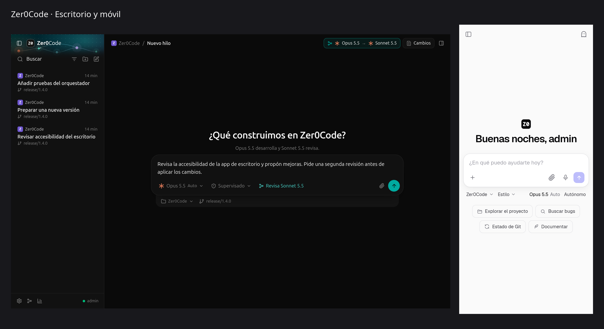
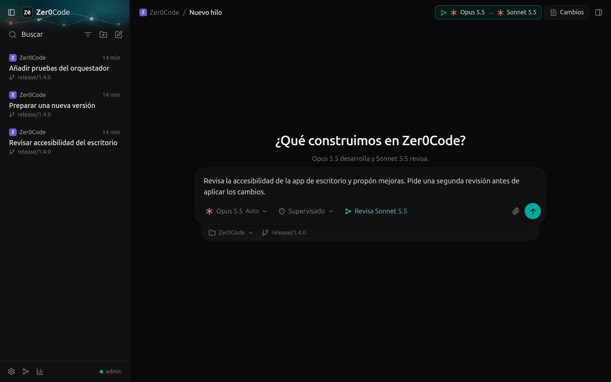
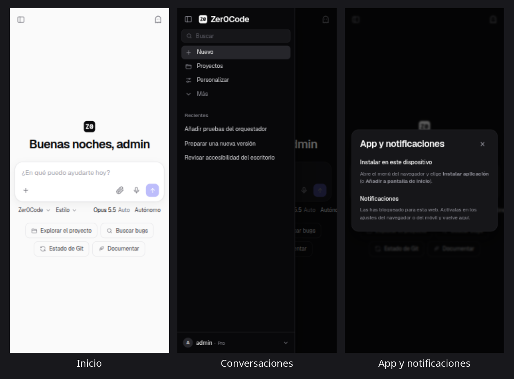
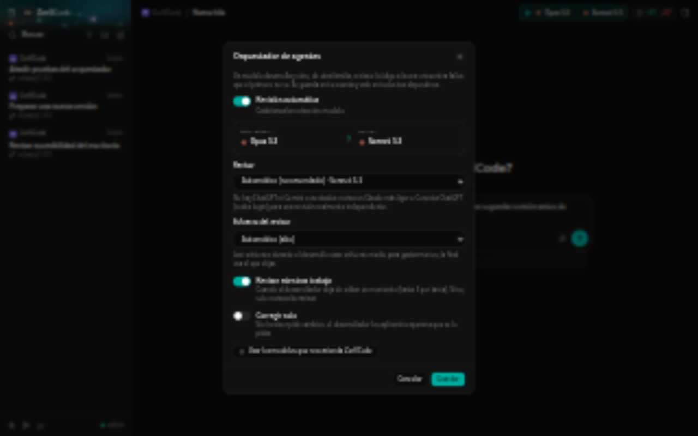
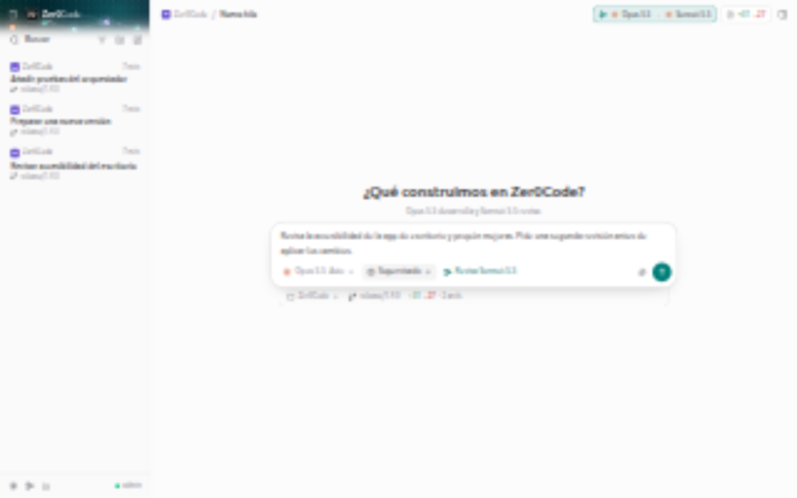
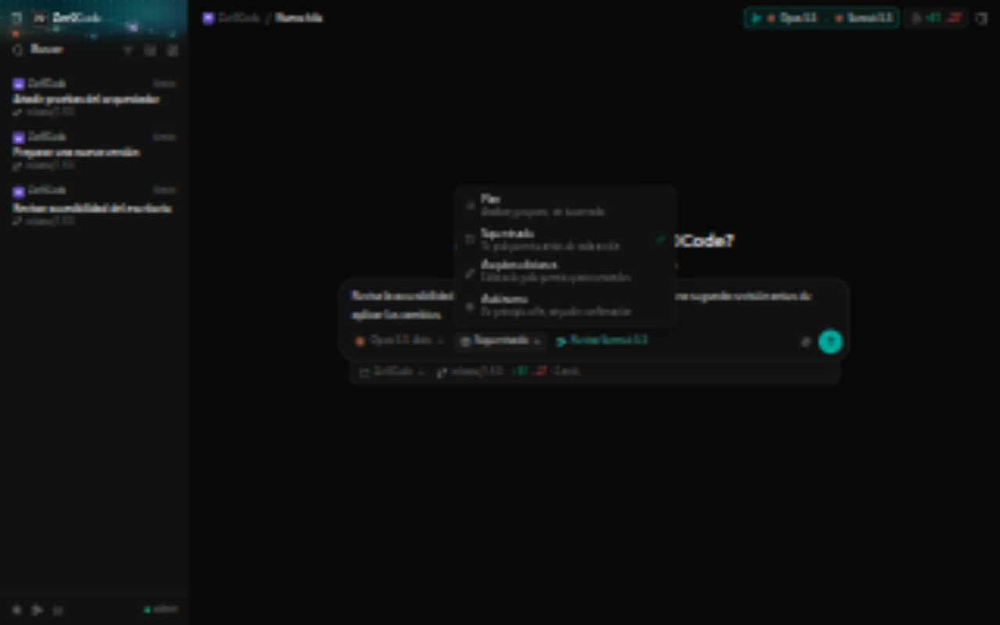
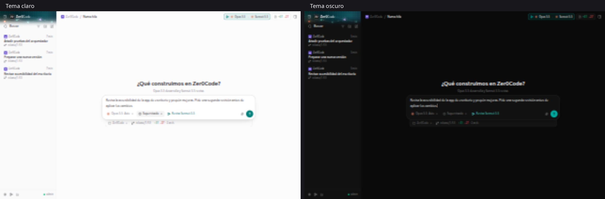

<p align="center">
  
</p>

<h3 align="center">Claude desarrolla, ChatGPT revisa. En tu escritorio, tu navegador y tu móvil.</h3>

<p align="center">
  Lanza una tarea desde el sofá, cierra la app y recibe un aviso cuando termine.<br>
  Un orquestador de agentes: un modelo escribe el código y otro, de otra familia, lo revisa a la vez.<br>
  Las mismas conversaciones en todos tus dispositivos.
</p>

<p align="center">
  <a href="https://github.com/Zer0Dev-exe/Zer0Code/releases/latest"></a>
  
  
  
  
</p>

<p align="center">
  
</p>

<p align="center">
  
</p>
<p align="center"><sub><b>La app de escritorio:</b> proyectos, hilos, modelos y revisión automática en una misma ventana. Capturas reales de la interfaz actual con hilos de ejemplo; no se han ejecutado tareas para generarlas.</sub></p>

---

## ¿Por qué Zer0Code?

Zer0Code es un orquestador de agentes con app de escritorio, web y móvil. Combina Claude Code, Codex y Gemini CLI en una misma interfaz y continúa tus conversaciones desde cualquier dispositivo:

- **🧑‍💻 Un equipo de agentes.** Claude desarrolla y ChatGPT (Codex) revisa el código mientras trabaja y al terminar. Si quieres, Claude corrige solo lo que el revisor señale. [Cómo funciona](#orquestador).
- **🖥️ App de escritorio** para Windows, macOS y Linux, además de la web y la app móvil. Todas enseñan **las mismas conversaciones**, en directo: empieza en el PC, sigue en el móvil.
- **📱 Una app en tu móvil.** Se instala desde el navegador en Android y iPhone, con su icono y a pantalla completa. Sin tiendas y sin avisos de seguridad.
- **⏳ Sigue trabajando aunque cierres.** Las tareas se ejecutan en el servidor: bloquea el móvil, vuelve en una hora y la respuesta estará ahí, continuando en directo.
- **🔔 Te avisa.** Notificación cuando Claude termina, falla o necesita tu permiso. Al tocarla, se abre esa conversación.
- **✅ Tú decides.** Antes de ejecutar un comando o editar un archivo, ves el diff o el comando y apruebas con un toque.
- **👥 Para ti o para tu equipo.** Varios usuarios, cada uno con sus carpetas, sus modos y su límite de gasto.
- **🔒 Es tuyo.** Corre en tu PC o en tu VPS. Tus claves y conversaciones no salen de ahí.

---

## 📦 Descargar

Descarga el instalador de tu sistema en la [**última versión**](https://github.com/Zer0Dev-exe/Zer0Code/releases/latest). Incluyen Node.js y Claude Code: no hace falta tener nada más instalado.

| Sistema | Archivo | Qué instala |
| :--- | :--- | :--- |
| 🖥️ **App de escritorio** · Windows | `Zer0Code-Desktop-…-win-x64.exe` | La app con ventana propia, con el servidor dentro o conectada al tuyo |
| 🖥️ **App de escritorio** · Linux | `Zer0Code-Desktop-…-linux-x86_64.AppImage` · `…-amd64.deb` · `…-arm64.deb` | Lo mismo, para x64 y ARM |
| 🖥️ **App de escritorio** · macOS (Apple Silicon) | `Zer0Code-Desktop-…-mac-arm64.dmg` | Lo mismo |
| 🪟 **Windows 10 y 11** (x64) | `Zer0Code-Setup-…-x64.exe` | El servidor, con accesos en el menú Inicio |
| 🐧 **Debian y Ubuntu** (x64 y ARM) | `zer0code_…_amd64.deb` · `zer0code_…_arm64.deb` | El servidor y el comando `zer0code` |
| 🍎 **macOS 12 o superior** (Apple Silicon) | `Zer0Code-…-arm64.dmg` | Zer0Code.app |
| 🤖 **Android 8 o superior** | `Zer0Code-….apk` | La app que se conecta a tu servidor |

Cada versión trae un `SHA256SUMS.txt` para comprobar que la descarga está intacta.

<details>
<summary><b>🖥️ App de escritorio</b></summary>

Es una interfaz propia pensada para orquestar agentes, al estilo de [T3 Code](https://github.com/pingdotgg/t3code): hilos en la barra lateral agrupados por proyecto, línea de tiempo del trabajo del agente, tarjetas de revisión de otro modelo y un panel de cambios con el diff. Avisa con notificaciones del sistema cuando una tarea termina o pide permiso. Al abrirla elige:

- **Conectar con mi servidor**: escribe la dirección de tu Zer0Code (VPS, Tailscale, tu casa). Verás las mismas conversaciones que en la web y en el móvil, en tiempo real. Es lo más cómodo si ya tienes un servidor.
- **Usar este equipo**: la app lleva el servidor dentro y no hay que montar nada. Tus chats y cuentas se quedan en este equipo. Con **Compartir en mi red**, el móvil o otro equipo de la misma Wi-Fi entra a esos mismos chats (menú *Zer0Code → Dirección para el móvil*).

En el modo local, cerrar la ventana la deja en la bandeja del sistema para que las tareas sigan; *Salir* detiene el servidor. Vincula tus cuentas desde *Zer0Code → Vincular cuentas* (Claude, ChatGPT y Gemini). Para cambiar de modo: *Zer0Code → Cambiar de servidor*.

Los datos viven en `%APPDATA%\Zer0Code` (Windows), `~/Library/Application Support/Zer0Code` (macOS) o `~/.config/Zer0Code` (Linux).

> [!NOTE]
> Los instaladores no están firmados con un certificado de pago: Windows muestra «Windows protegió su PC» (*Más información → Ejecutar de todas formas*) y macOS pide *Ajustes del Sistema → Privacidad y seguridad → Abrir igualmente*. En Linux, el AppImage necesita `chmod +x`.
</details>

<details>
<summary><b>🪟 Windows</b></summary>

1. Ejecuta `Zer0Code-Setup-…-x64.exe`. Se instala para tu usuario, sin pedir permisos de administrador.
2. En el menú Inicio, abre **Vincular cuenta de Claude** e inicia sesión.
3. Abre **Zer0Code**: arranca el servidor y abre la web. Mientras la ventana esté abierta, Zer0Code funciona.

Opcionalmente, el instalador puede hacer que arranque solo al encender el equipo. Tu configuración y tus conversaciones se guardan en `%APPDATA%\Zer0Code` y se conservan al actualizar o desinstalar.

> [!NOTE]
> Como el instalador no está firmado con un certificado de pago, Windows muestra **«Windows protegió su PC»**: pulsa *Más información* → *Ejecutar de todas formas*. La primera vez, el firewall pregunta si Zer0Code puede usar la red. Acepta si quieres entrar desde el móvil.
</details>

<details>
<summary><b>🐧 Debian y Ubuntu</b></summary>

```bash
sudo apt install ./zer0code_*_amd64.deb   # o el _arm64.deb (Raspberry Pi y servidores ARM)
zer0code login     # vincula tu cuenta de Claude
zer0code enable    # lo deja como servicio: arranca solo y sigue aunque cierres el SSH
```

Usa tu propio usuario, no root, para que Claude pueda trabajar en tus proyectos. `zer0code help` muestra todos los comandos: `logs`, `config`, `restart`, `status`… La configuración está en `~/.config/zer0code/.env` y los datos en `~/.local/share/zer0code`.
</details>

<details>
<summary><b>🍎 macOS</b></summary>

1. Abre el `.dmg` y arrastra **Zer0Code** a *Aplicaciones*.
2. Vincula tu cuenta de Claude desde la Terminal:
   ```bash
   /Applications/Zer0Code.app/Contents/Resources/app/node_modules/.bin/claude auth login
   ```
3. Abre Zer0Code: arranca el servidor y abre la web. Para pararlo, sal de la app desde el Dock.

Tus datos se guardan en `~/Library/Application Support/Zer0Code`.

> [!NOTE]
> La app no está notarizada por Apple (hace falta una cuenta de desarrollador de pago), así que la primera vez macOS no la deja abrir. Ve a **Ajustes del Sistema → Privacidad y seguridad** y pulsa **Abrir igualmente**. Solo hay que hacerlo una vez.
</details>

<details>
<summary><b>🤖 Android</b></summary>

1. Descarga el `.apk` en el móvil y ábrelo. Android pedirá permitir instalar apps desde el navegador o el gestor de archivos: es el aviso normal para cualquier app que no viene de Play Store.
2. Abre Zer0Code y escribe la dirección de **tu** servidor, por ejemplo `https://mi-servidor.tailnet.ts.net` o `http://192.168.1.50:5050`. La app comprueba que es un servidor de Zer0Code y la recuerda.
3. Para cambiar de servidor: menú de usuario → **App y notificaciones** → *Cambiar de servidor*.

La app de Android no recibe notificaciones push. Si quieres que el móvil te avise cuando Claude termine, instala la app desde Chrome (PWA, más abajo); puedes tener las dos.
</details>

---

## 🔄 Actualizaciones

Cuando publicas un release en GitHub, la **app de escritorio** y la **app de Android** avisan solas y se actualizan desde dentro. Miran el último release (que no sea prerelease) y lo comparan con su versión.

| App | Cómo avisa | Cómo se actualiza |
| :--- | :--- | :--- |
| 🖥️ **Windows** (instalador) y **Linux** (AppImage) | Pastilla «Actualizar a vX» en la barra lateral y aviso del sistema | Descarga, verifica el SHA-256 contra `SHA256SUMS.txt`, se reemplaza y se reinicia sola |
| 🖥️ **Linux** (.deb) y **macOS** | La misma pastilla | Descarga (también verificada) y abre el instalador del sistema |
| 🤖 **Android** | Un diálogo al abrir la app (como mucho cada 6 horas) | Descarga el APK y abre el instalador de Android; la primera vez pide el permiso de «instalar apps desconocidas» |

- Se comprueba al arrancar y cada pocas horas; también a mano en **Ajustes → Buscar actualizaciones** (escritorio, y *Zer0Code → Buscar actualizaciones* en el menú) o tocando la versión en la pantalla de servidor de Android.
- **Omitir esta versión** la deja de ofrecer hasta que salga otra.
- Un release recién publicado no se ofrece hasta que CI ha subido los instaladores y `SHA256SUMS.txt` (tarda unos minutos).
- Un APK solo se instala si está firmado con la misma clave que la app instalada (lo exige Android), y la app de escritorio descarta cualquier descarga cuyo hash no coincida.

**Para sacar una versión:** sube `version` en `package.json`, crea el release con el tag `vX.Y.Z` y publícalo. El workflow *Instaladores* compila todo con esa versión y lo adjunta; las apps que tengan una versión anterior la ofrecerán.

> [!NOTE]
> El servidor (web) no se actualiza por esta vía: el VPS o el PC donde corre se actualiza con `git pull` o con el instalador correspondiente. La web y el móvil (PWA) siempre muestran la versión que sirve tu servidor.

---

## 🚀 Desde el código fuente

Necesitas [Node.js](https://nodejs.org) 22 o superior y [pnpm](https://pnpm.io) (o npm).

```bash
git clone https://github.com/Zer0Dev-exe/Zer0Code.git
cd Zer0Code
pnpm install
pnpm auth:login      # vincula tu suscripción de Claude (o pon ANTHROPIC_API_KEY en .env)
pnpm start
```

Abre **http://localhost:5050** y entra con `admin` / `zer0code`. La primera vez te pedirá cambiar la contraseña.

¿Lo quieres en un servidor y en el móvil? Mira [Instalar en un servidor](#servidor): es un solo comando.

---

## 📱 En tu móvil, como una app más

<p align="center">
  
</p>

- **Se instala desde el navegador.** En Android (Chrome): ⋮ → *Instalar aplicación*. En iPhone (Safari): Compartir → *Añadir a pantalla de inicio*.
- **Notificaciones push** cuando no tienes la app a la vista. En iPhone necesitan iOS 16.4 o superior y la app instalada.
- **Abre al instante** y, sin conexión, muestra la app en vez de un error del navegador.
- **Dictado por voz** para escribir sin teclado.

Todo se activa desde el menú de usuario → **App y notificaciones**.

---

<a id="orquestador"></a>

## 🧑‍💻 Orquestador de agentes

Un modelo desarrolla y otro lo revisa **a la vez**. Se maneja desde la **app de escritorio** (botón *Revisa …* del compositor o *Orquestador* en la barra lateral) y los ajustes se guardan en tu cuenta del servidor. La web y el móvil no cambian: siguen con sus mismos chats, y las revisiones se ven en la app de escritorio.

- **Revisión en vivo.** Cuando el desarrollador deja de editar un momento, el revisor lee lo hecho (`git diff`) y deja sus comentarios en el chat, sin interrumpirlo. Hasta 3 por tarea, con un esfuerzo medio para gastar menos.
- **Revisión final.** Al terminar, una revisión del estado final con el esfuerzo que elijas. Acaba en **Todo bien** o **Propone cambios**.
- **Corregir solo** (opcional). Si el revisor pide cambios, el desarrollador los aplica como un turno nuevo, hasta N rondas. Si no cree que algo sea un problema, lo explica en vez de cambiarlo.
- **El revisor solo lee.** Corre en solo lectura: no puede tocar tus archivos ni ejecutar nada que los cambie. Recuerda lo que ya señaló en rondas anteriores.

**Qué modelos usa (los elige Zer0Code):** el desarrollador es el Claude por defecto del catálogo (Opus) con esfuerzo alto; el revisor, el mejor modelo de ChatGPT que publique Codex, también con esfuerzo alto. Son de **familias distintas a propósito**: los fallos de un modelo no suelen coincidir con los del otro, que es lo que hace útil una segunda opinión. Si ChatGPT no está conectado, revisa Gemini; y si tampoco, un Claude Sonnet (mejor que nada, pero con el mismo punto ciego). Nada está fijado a un id: se calcula con el catálogo vivo, así que sigue valiendo cuando salgan modelos nuevos. Puedes elegir otro revisor en los ajustes o pulsar *Usar los modelos que recomienda Zer0Code*.

<table>
  <tr>
    <td width="50%"></td>
    <td width="50%"></td>
  </tr>
  <tr>
    <td align="center"><sub>Ajustes del orquestador</sub></td>
    <td align="center"><sub>La misma interfaz en tema claro</sub></td>
  </tr>
</table>

Conecta ChatGPT en el servidor con `codex login --device-auth` (o desde la app de escritorio: *Vincular cuentas*).

---

## ✅ Tú tienes el control

<p align="center">
  
</p>

Cuando Claude necesita usar una herramienta, aparece una tarjeta con lo que quiere hacer: el comando exacto o el diff del archivo. Eliges **Denegar**, **Permitir siempre** en esa conversación o **Permitir**. Las peticiones pendientes te esperan en todos tus dispositivos y reaparecen al reconectar.

Elige cuánta libertad le das en cada momento:

| Modo | Qué hace |
| :--- | :--- |
| **Manual** | Pide permiso antes de cada acción. |
| **Aceptar ediciones** | Edita archivos sin preguntar y pide permiso para los comandos. |
| **Autónomo** | Trabaja sin pausas de confirmación. |
| **Plan** | Analiza y propone un plan antes de tocar nada. |

---

## 🎨 Claro, oscuro o como tu sistema

<p align="center">
  
</p>

Interfaz propia de Zer0Code, con icono ZØ, tonos neutros y temas claro y oscuro. En la web y el móvil puedes personalizar el acento y la tipografía. Mientras el agente trabaja ves cómo piensa (razonamiento desplegable), cada herramienta que usa y el diff de cada cambio, en tiempo real.

---

## ✨ Todo lo que incluye

| Función | Qué te da |
| :--- | :--- |
| 🤖 **Modelos** | Selector con el catálogo de Claude sincronizado con Anthropic (Fable, Opus, Sonnet, Haiku) y nivel de esfuerzo. |
| 📂 **Proyectos** | Explorador de carpetas para elegir dónde trabaja Claude, con carpetas recientes. |
| 📎 **Adjuntos** | Imágenes y archivos con vista previa. Son temporales: no se guardan en el historial. |
| 🕶️ **Incógnito** | Conversaciones que no se guardan y se borran al salir. |
| 📊 **Uso y gasto** | Límites de tu suscripción (sesión y semana) y gasto por modelo. |
| ⌨️ **Comandos** | Escribe `/` para ver los atajos disponibles. |
| 🛡️ **Seguridad** | Contraseñas cifradas, cambio obligatorio en el primer acceso y cierre de sesión en todos los dispositivos. |
| 💻 **Multiplataforma** | Windows, Linux y macOS. |

---

<a id="servidor"></a>

## 🖥️ Instalar en un servidor (SSH)

En un servidor Linux con systemd (un VPS, una Raspberry Pi o un PC al que entras por SSH):

```bash
git clone https://github.com/Zer0Dev-exe/Zer0Code.git
cd Zer0Code
pnpm auth:login                          # o ANTHROPIC_API_KEY en .env
bash deploy/install-linux.sh --tailscale
```

El script instala las dependencias, crea el `.env` si no existe y deja Zer0Code como **servicio del sistema**:
- Arranca solo al encender la máquina y se reinicia si falla.
- **Sigue funcionando aunque cierres la sesión SSH.**

Con `--tailscale`, la web queda publicada en `https://<tu-maquina>.<tu-red>.ts.net` con un **certificado HTTPS válido** y solo es accesible desde tus dispositivos de [Tailscale](https://tailscale.com), sin abrir puertos en el router. Sin esa opción, se sirve por HTTP en el puerto del `.env`.

| Para… | Comando |
| :--- | :--- |
| Ver el estado | `systemctl status zer0code` |
| Ver los logs en directo | `journalctl -u zer0code -f` |
| Reiniciar | `sudo systemctl restart zer0code` |

### Instalar la app en el móvil

1. Instala Tailscale en el móvil e inicia sesión con la misma cuenta.
2. Abre la dirección `https://…ts.net` que muestra el script.
3. Instala la app: **Android** (Chrome) → ⋮ → *Instalar aplicación*. **iPhone** (Safari) → Compartir → *Añadir a pantalla de inicio*.
4. Dentro de la app: menú de usuario → **App y notificaciones** → *Activar notificaciones*.

### Cada instalación es independiente

La app no es un instalador común: se instala **desde tu propio servidor** y solo habla con él. Quien instale Zer0Code en su máquina tendrá su propia app, sin acceso a la tuya.

- Las claves de las notificaciones, los usuarios, las contraseñas y las sesiones se generan en cada servidor, dentro de `data/`. Esa carpeta nunca se sube al repositorio, igual que el `.env`.
- Para entrar hace falta un usuario de ese servidor. Con Tailscale, además, solo llegan tus propios dispositivos.
- Dale a tu app su propio nombre con `APP_NAME` en el `.env` (por ejemplo `APP_NAME=Claude VPS`).

---

## ⚙️ Configuración

Todo se configura en el archivo `.env` (parte de `.env.example`):

```env
# Hoster: compartes tu cuenta de Claude con los usuarios. Client: cada uno pone su propia clave.
MODE=Hoster

# Administrador. El resto de usuarios se crean desde la web.
ZER0CODE_USER=admin
ZER0CODE_PASSWORD=zer0code

# Nombre de la app en el móvil y en la pestaña
# APP_NAME=Zer0Code

PORT=5050
# Pon 127.0.0.1 para que solo se pueda entrar desde este equipo (p. ej. con Tailscale)
# HOST=127.0.0.1

# Opcional: clave de API en vez de suscripción (ideal en un VPS sin navegador)
# ANTHROPIC_API_KEY=sk-ant-api03-...
```

La contraseña del `.env` solo se usa la primera vez. Después se guarda cifrada y se cambia desde la web (**Perfil → Seguridad**). Si la olvidas, pon una nueva en el `.env` y reinicia.

### Cuenta de Claude: dos formas

- **Con tu suscripción (Pro, Max o Team):** ejecuta `pnpm auth:login`. Se abre el navegador para iniciar sesión y la sesión queda guardada en el equipo. Compruébala con `pnpm auth:status`.
- **Con una clave de API:** pon `ANTHROPIC_API_KEY` en el `.env`, con créditos de [console.anthropic.com](https://console.anthropic.com).

### Modos Hoster y Client

| | `MODE=Hoster` | `MODE=Client` |
| :--- | :--- | :--- |
| **Cuenta que se usa** | La del anfitrión (suscripción o clave del `.env`) | La clave de API de cada persona |
| **Cuenta del anfitrión** | Se comparte su cuota de uso | Totalmente aislada e inaccesible |
| **Dónde se guarda la clave** | En el servidor | En el navegador de cada persona |
| **Ideal para** | Uso personal, familia o un equipo de confianza | Compartir el servidor con más gente |

---

## 👥 Multiusuario

Varias personas pueden usar el mismo servidor, cada una con su cuenta. Es especialmente útil en `MODE=Hoster`: el anfitrión decide hasta dónde llega cada usuario con su suscripción.

| | Administrador | Usuario |
| :--- | :--- | :--- |
| **Cómo se crea** | Con `ZER0CODE_USER` y `ZER0CODE_PASSWORD` del `.env` | Lo crea el administrador desde la web |
| **Carpetas** | Cualquiera del equipo | Solo sus carpetas permitidas (y subcarpetas) |
| **Modos de ejecución** | Todos | Los que le conceda el administrador |
| **Límite de gasto** | Sin límite | Límite mensual opcional |
| **Gestionar usuarios, modelos y gasto** | Sí | No |

**Crear un usuario:** menú de tu perfil (abajo a la izquierda) → **Usuarios** → **Nuevo usuario**. Indica:
- Una contraseña temporal, que tendrá que cambiar al entrar.
- Sus carpetas permitidas, una por línea.
- Los modos que puede usar.
- Si quieres, un límite mensual en USD.

**Qué queda separado:** cada usuario tiene sus propias conversaciones, carpeta de proyecto, tareas (una en marcha a la vez, sin bloquear a los demás), peticiones de permiso y gasto. El administrador ve el gasto total.

**Límite mensual:** cuenta lo gastado con la cuenta del anfitrión en el mes natural, a precio de tarifa de la API. Con suscripción es un equivalente, no un cobro real. Si el usuario pone su propia clave, ese gasto no cuenta.

> [!WARNING]
> Las lecturas y ediciones fuera de las carpetas permitidas se deniegan automáticamente, pero los **comandos de terminal (Bash)** no se pueden limitar por carpeta. En **Autónomo** se ejecutan sin preguntar: concede ese modo solo a personas de total confianza.

---

## 📁 Estructura del proyecto

```
Zer0Code/
├── deploy/install-linux.sh        # Instalación desde el código como servicio systemd (+ HTTPS con Tailscale)
├── desktop/                       # App de escritorio (Electron): Windows, macOS y Linux
├── packaging/                     # Instaladores: Windows (Inno Setup), .deb, .dmg y app de Android
├── .github/workflows/release.yml  # Compila, prueba y adjunta los instaladores a cada release
├── docs/screenshots/              # Capturas del README
├── server/
│   ├── index.js                   # Servidor Express y WebSocket
│   ├── claudeRunner.js            # Ejecuta Claude Code (Windows, Linux y macOS)
│   ├── gitInfo.js                 # Rama y cambios sin guardar (panel de diff del escritorio)
│   ├── orchestrator.js            # Orquestador: elección de modelos y revisor que trabaja a la vez
│   ├── sessionManager.js          # Historial de conversaciones (por usuario)
│   ├── auth.js                    # Autenticación, sesiones y usuarios
│   ├── accessPolicy.js            # Carpetas y modos permitidos por usuario
│   ├── permissionManager.js       # Peticiones de permiso pendientes
│   ├── permissionMcp.js           # Servidor MCP que pide permisos a la web
│   ├── pushManager.js             # Notificaciones push de la app instalada
│   ├── modelsManager.js           # Catálogo de modelos
│   ├── usageManager.js            # Gasto por modelo, límites del plan y límite mensual
│   └── workspaceManager.js        # Explorador de carpetas
└── public/
    ├── desktop/                   # Interfaz de la app de escritorio (la sirve el servidor en /desktop/)
    ├── index.html                 # Interfaz
    ├── css/style.css              # Estilos (tema claro y oscuro)
    ├── js/app.js                  # Lógica del cliente
    ├── manifest.json              # App instalable (PWA)
    └── sw.js                      # Service worker: instalación, sin conexión y notificaciones
```

---

## 🛠️ Compilar la app de escritorio

```bash
bash packaging/stage-app.sh dist/stage --no-runtime   # el servidor y los CLIs que van dentro
cd desktop && npm ci
npm start                                              # probar (usa el servidor del repositorio)
npx electron-builder                                   # genera los instaladores en dist/desktop
```

Se compila en el sistema para el que se empaqueta (Claude Code trae un binario por plataforma); el workflow *Instaladores* lo hace en cada release.

---

## 📄 Licencia

[MIT](LICENSE). Hecho para acompañar a [Claude Code](https://claude.com/claude-code) de Anthropic. No es un producto oficial de Anthropic.
