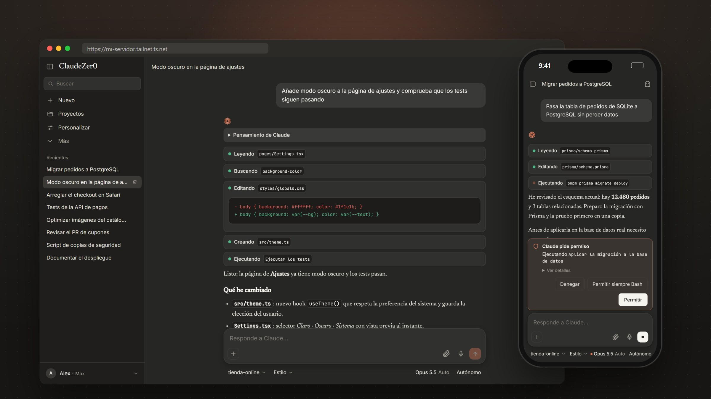
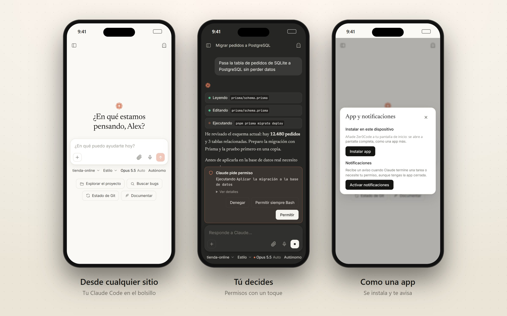
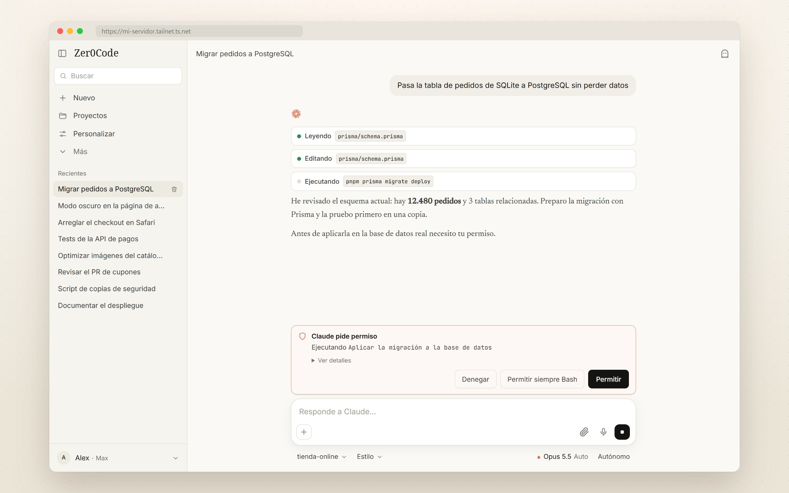
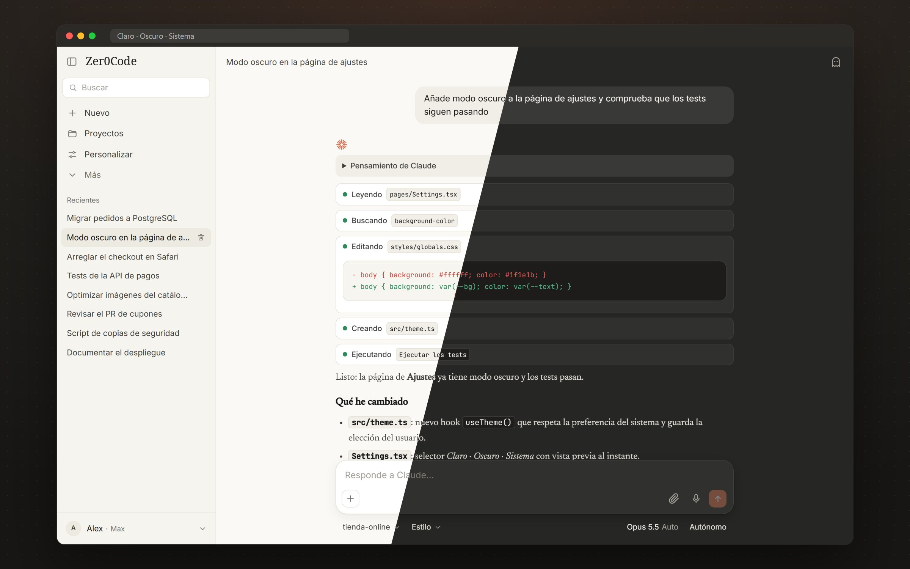

<p align="center">
  
</p>

<h3 align="center">Claude Code en tu navegador y en tu móvil. Desde tu propio servidor.</h3>

<p align="center">
  Lanza una tarea desde el sofá, cierra la app y recibe un aviso cuando Claude termine.<br>
  Una interfaz cálida al estilo de claude.ai, sobre el Claude Code de siempre.
</p>

<p align="center">
  <a href="https://github.com/Zer0Dev-exe/ClaudeZer0/releases/latest"></a>
  
  
  
  
</p>

<p align="center">
  
</p>

---

## ¿Por qué ClaudeZer0?

Claude Code es potente, pero vive en una terminal. ClaudeZer0 lo pone en una web que puedes abrir desde cualquier dispositivo, sin renunciar a nada:

- **📱 Una app en tu móvil.** Se instala desde el navegador en Android y iPhone, con su icono y a pantalla completa. Sin tiendas y sin avisos de seguridad.
- **⏳ Sigue trabajando aunque cierres.** Las tareas se ejecutan en el servidor: bloquea el móvil, vuelve en una hora y la respuesta estará ahí, continuando en directo.
- **🔔 Te avisa.** Notificación cuando Claude termina, falla o necesita tu permiso. Al tocarla, se abre esa conversación.
- **✅ Tú decides.** Antes de ejecutar un comando o editar un archivo, ves el diff o el comando y apruebas con un toque.
- **👥 Para ti o para tu equipo.** Varios usuarios, cada uno con sus carpetas, sus modos y su límite de gasto.
- **🔒 Es tuyo.** Corre en tu PC o en tu VPS. Tus claves y conversaciones no salen de ahí.

---

## 📦 Descargar

Descarga el instalador de tu sistema en la [**última versión**](https://github.com/Zer0Dev-exe/ClaudeZer0/releases/latest). Incluyen Node.js y Claude Code: no hace falta tener nada más instalado.

| Sistema | Archivo | Qué instala |
| :--- | :--- | :--- |
| 🪟 **Windows 10 y 11** (x64) | `ClaudeZer0-Setup-…-x64.exe` | El servidor, con accesos en el menú Inicio |
| 🐧 **Debian y Ubuntu** (x64 y ARM) | `claudezer0_…_amd64.deb` · `claudezer0_…_arm64.deb` | El servidor y el comando `claudezer0` |
| 🍎 **macOS 12 o superior** (Apple Silicon) | `ClaudeZer0-…-arm64.dmg` | ClaudeZer0.app |
| 🤖 **Android 8 o superior** | `ClaudeZer0-….apk` | La app que se conecta a tu servidor |

Cada versión trae un `SHA256SUMS.txt` para comprobar que la descarga está intacta.

<details>
<summary><b>🪟 Windows</b></summary>

1. Ejecuta `ClaudeZer0-Setup-…-x64.exe`. Se instala para tu usuario, sin pedir permisos de administrador.
2. En el menú Inicio, abre **Vincular cuenta de Claude** e inicia sesión.
3. Abre **ClaudeZer0**: arranca el servidor y abre la web. Mientras la ventana esté abierta, ClaudeZer0 funciona.

Opcionalmente, el instalador puede hacer que arranque solo al encender el equipo. Tu configuración y tus conversaciones se guardan en `%APPDATA%\ClaudeZer0` y se conservan al actualizar o desinstalar.

> [!NOTE]
> Como el instalador no está firmado con un certificado de pago, Windows muestra **«Windows protegió su PC»**: pulsa *Más información* → *Ejecutar de todas formas*. La primera vez, el firewall pregunta si ClaudeZer0 puede usar la red. Acepta si quieres entrar desde el móvil.
</details>

<details>
<summary><b>🐧 Debian y Ubuntu</b></summary>

```bash
sudo apt install ./claudezer0_*_amd64.deb   # o el _arm64.deb (Raspberry Pi y servidores ARM)
claudezer0 login     # vincula tu cuenta de Claude
claudezer0 enable    # lo deja como servicio: arranca solo y sigue aunque cierres el SSH
```

Usa tu propio usuario, no root, para que Claude pueda trabajar en tus proyectos. `claudezer0 help` muestra todos los comandos: `logs`, `config`, `restart`, `status`… La configuración está en `~/.config/claudezer0/.env` y los datos en `~/.local/share/claudezer0`.
</details>

<details>
<summary><b>🍎 macOS</b></summary>

1. Abre el `.dmg` y arrastra **ClaudeZer0** a *Aplicaciones*.
2. Vincula tu cuenta de Claude desde la Terminal:
   ```bash
   /Applications/ClaudeZer0.app/Contents/Resources/app/node_modules/.bin/claude auth login
   ```
3. Abre ClaudeZer0: arranca el servidor y abre la web. Para pararlo, sal de la app desde el Dock.

Tus datos se guardan en `~/Library/Application Support/ClaudeZer0`.

> [!NOTE]
> La app no está notarizada por Apple (hace falta una cuenta de desarrollador de pago), así que la primera vez macOS no la deja abrir. Ve a **Ajustes del Sistema → Privacidad y seguridad** y pulsa **Abrir igualmente**. Solo hay que hacerlo una vez.
</details>

<details>
<summary><b>🤖 Android</b></summary>

1. Descarga el `.apk` en el móvil y ábrelo. Android pedirá permitir instalar apps desde el navegador o el gestor de archivos: es el aviso normal para cualquier app que no viene de Play Store.
2. Abre ClaudeZer0 y escribe la dirección de **tu** servidor, por ejemplo `https://mi-servidor.tailnet.ts.net` o `http://192.168.1.50:5050`. La app comprueba que es un servidor de ClaudeZer0 y la recuerda.
3. Para cambiar de servidor: menú de usuario → **App y notificaciones** → *Cambiar de servidor*.

La app de Android no recibe notificaciones push. Si quieres que el móvil te avise cuando Claude termine, instala la app desde Chrome (PWA, más abajo); puedes tener las dos.
</details>

---

## 🚀 Desde el código fuente

Necesitas [Node.js](https://nodejs.org) 22 o superior y [pnpm](https://pnpm.io) (o npm).

```bash
git clone https://github.com/Zer0Dev-exe/ClaudeZer0.git
cd ClaudeZer0
pnpm install
pnpm auth:login      # vincula tu suscripción de Claude (o pon ANTHROPIC_API_KEY en .env)
pnpm start
```

Abre **http://localhost:5050** y entra con `admin` / `claudezer0`. La primera vez te pedirá cambiar la contraseña.

¿Lo quieres en un servidor y en el móvil? Mira [Instalar en un servidor](#servidor): es un solo comando.

---

## 📱 En tu móvil, como una app más

<p align="center">
  
</p>

- **Se instala desde el navegador.** En Android (Chrome): ⋮ → *Instalar aplicación*. En iPhone (Safari): Compartir → *Añadir a pantalla de inicio*.
- **Notificaciones push** cuando no tienes la app a la vista. En iPhone necesitan iOS 16.4 o superior y la app instalada.
- **Abre al instante** y, sin conexión, muestra la app en vez de un error del navegador.
- **Dictado por voz** para escribir sin teclado.

Todo se activa desde el menú de usuario → **App y notificaciones**.

---

## ✅ Tú tienes el control

<p align="center">
  
</p>

Cuando Claude necesita usar una herramienta, aparece una tarjeta con lo que quiere hacer: el comando exacto o el diff del archivo. Eliges **Denegar**, **Permitir siempre** en esa conversación o **Permitir**. Las peticiones pendientes te esperan en todos tus dispositivos y reaparecen al reconectar.

Elige cuánta libertad le das en cada momento:

| Modo | Qué hace |
| :--- | :--- |
| **Manual** | Pide permiso antes de cada acción. |
| **Aceptar ediciones** | Edita archivos sin preguntar y pide permiso para los comandos. |
| **Autónomo** | Trabaja sin pausas de confirmación. |
| **Plan** | Analiza y propone un plan antes de tocar nada. |

---

## 🎨 Claro, oscuro o como tu sistema

<p align="center">
  
</p>

Paleta cálida con acentos terracota y tipografía editorial, inspirada en claude.ai. Mientras Claude trabaja ves cómo piensa (razonamiento desplegable), cada herramienta que usa y el diff de cada cambio, en tiempo real.

---

## ✨ Todo lo que incluye

| Función | Qué te da |
| :--- | :--- |
| 🤖 **Modelos** | Selector con el catálogo de Claude sincronizado con Anthropic (Fable, Opus, Sonnet, Haiku) y nivel de esfuerzo. |
| 📂 **Proyectos** | Explorador de carpetas para elegir dónde trabaja Claude, con carpetas recientes. |
| 📎 **Adjuntos** | Imágenes y archivos con vista previa. Son temporales: no se guardan en el historial. |
| 🕶️ **Incógnito** | Conversaciones que no se guardan y se borran al salir. |
| 📊 **Uso y gasto** | Límites de tu suscripción (sesión y semana) y gasto por modelo. |
| ⌨️ **Comandos** | Escribe `/` para ver los atajos disponibles. |
| 🛡️ **Seguridad** | Contraseñas cifradas, cambio obligatorio en el primer acceso y cierre de sesión en todos los dispositivos. |
| 💻 **Multiplataforma** | Windows, Linux y macOS. |

---

<a id="servidor"></a>

## 🖥️ Instalar en un servidor (SSH)

En un servidor Linux con systemd (un VPS, una Raspberry Pi o un PC al que entras por SSH):

```bash
git clone https://github.com/Zer0Dev-exe/ClaudeZer0.git
cd ClaudeZer0
pnpm auth:login                          # o ANTHROPIC_API_KEY en .env
bash deploy/install-linux.sh --tailscale
```

El script instala las dependencias, crea el `.env` si no existe y deja ClaudeZer0 como **servicio del sistema**:
- Arranca solo al encender la máquina y se reinicia si falla.
- **Sigue funcionando aunque cierres la sesión SSH.**

Con `--tailscale`, la web queda publicada en `https://<tu-maquina>.<tu-red>.ts.net` con un **certificado HTTPS válido** y solo es accesible desde tus dispositivos de [Tailscale](https://tailscale.com), sin abrir puertos en el router. Sin esa opción, se sirve por HTTP en el puerto del `.env`.

| Para… | Comando |
| :--- | :--- |
| Ver el estado | `systemctl status claudezer0` |
| Ver los logs en directo | `journalctl -u claudezer0 -f` |
| Reiniciar | `sudo systemctl restart claudezer0` |

### Instalar la app en el móvil

1. Instala Tailscale en el móvil e inicia sesión con la misma cuenta.
2. Abre la dirección `https://…ts.net` que muestra el script.
3. Instala la app: **Android** (Chrome) → ⋮ → *Instalar aplicación*. **iPhone** (Safari) → Compartir → *Añadir a pantalla de inicio*.
4. Dentro de la app: menú de usuario → **App y notificaciones** → *Activar notificaciones*.

### Cada instalación es independiente

La app no es un instalador común: se instala **desde tu propio servidor** y solo habla con él. Quien instale ClaudeZer0 en su máquina tendrá su propia app, sin acceso a la tuya.

- Las claves de las notificaciones, los usuarios, las contraseñas y las sesiones se generan en cada servidor, dentro de `data/`. Esa carpeta nunca se sube al repositorio, igual que el `.env`.
- Para entrar hace falta un usuario de ese servidor. Con Tailscale, además, solo llegan tus propios dispositivos.
- Dale a tu app su propio nombre con `APP_NAME` en el `.env` (por ejemplo `APP_NAME=Claude VPS`).

---

## ⚙️ Configuración

Todo se configura en el archivo `.env` (parte de `.env.example`):

```env
# Hoster: compartes tu cuenta de Claude con los usuarios. Client: cada uno pone su propia clave.
MODE=Hoster

# Administrador. El resto de usuarios se crean desde la web.
CLAUDEZER0_USER=admin
CLAUDEZER0_PASSWORD=claudezer0

# Nombre de la app en el móvil y en la pestaña
# APP_NAME=ClaudeZer0

PORT=5050
# Pon 127.0.0.1 para que solo se pueda entrar desde este equipo (p. ej. con Tailscale)
# HOST=127.0.0.1

# Opcional: clave de API en vez de suscripción (ideal en un VPS sin navegador)
# ANTHROPIC_API_KEY=sk-ant-api03-...
```

La contraseña del `.env` solo se usa la primera vez. Después se guarda cifrada y se cambia desde la web (**Perfil → Seguridad**). Si la olvidas, pon una nueva en el `.env` y reinicia.

### Cuenta de Claude: dos formas

- **Con tu suscripción (Pro, Max o Team):** ejecuta `pnpm auth:login`. Se abre el navegador para iniciar sesión y la sesión queda guardada en el equipo. Compruébala con `pnpm auth:status`.
- **Con una clave de API:** pon `ANTHROPIC_API_KEY` en el `.env`, con créditos de [console.anthropic.com](https://console.anthropic.com).

### Modos Hoster y Client

| | `MODE=Hoster` | `MODE=Client` |
| :--- | :--- | :--- |
| **Cuenta que se usa** | La del anfitrión (suscripción o clave del `.env`) | La clave de API de cada persona |
| **Cuenta del anfitrión** | Se comparte su cuota de uso | Totalmente aislada e inaccesible |
| **Dónde se guarda la clave** | En el servidor | En el navegador de cada persona |
| **Ideal para** | Uso personal, familia o un equipo de confianza | Compartir el servidor con más gente |

---

## 👥 Multiusuario

Varias personas pueden usar el mismo servidor, cada una con su cuenta. Es especialmente útil en `MODE=Hoster`: el anfitrión decide hasta dónde llega cada usuario con su suscripción.

| | Administrador | Usuario |
| :--- | :--- | :--- |
| **Cómo se crea** | Con `CLAUDEZER0_USER` y `CLAUDEZER0_PASSWORD` del `.env` | Lo crea el administrador desde la web |
| **Carpetas** | Cualquiera del equipo | Solo sus carpetas permitidas (y subcarpetas) |
| **Modos de ejecución** | Todos | Los que le conceda el administrador |
| **Límite de gasto** | Sin límite | Límite mensual opcional |
| **Gestionar usuarios, modelos y gasto** | Sí | No |

**Crear un usuario:** menú de tu perfil (abajo a la izquierda) → **Usuarios** → **Nuevo usuario**. Indica:
- Una contraseña temporal, que tendrá que cambiar al entrar.
- Sus carpetas permitidas, una por línea.
- Los modos que puede usar.
- Si quieres, un límite mensual en USD.

**Qué queda separado:** cada usuario tiene sus propias conversaciones, carpeta de proyecto, tareas (una en marcha a la vez, sin bloquear a los demás), peticiones de permiso y gasto. El administrador ve el gasto total.

**Límite mensual:** cuenta lo gastado con la cuenta del anfitrión en el mes natural, a precio de tarifa de la API. Con suscripción es un equivalente, no un cobro real. Si el usuario pone su propia clave, ese gasto no cuenta.

> [!WARNING]
> Las lecturas y ediciones fuera de las carpetas permitidas se deniegan automáticamente, pero los **comandos de terminal (Bash)** no se pueden limitar por carpeta. En **Autónomo** se ejecutan sin preguntar: concede ese modo solo a personas de total confianza.

---

## 📁 Estructura del proyecto

```
ClaudeZer0/
├── deploy/install-linux.sh        # Instalación desde el código como servicio systemd (+ HTTPS con Tailscale)
├── packaging/                     # Instaladores: Windows (Inno Setup), .deb, .dmg y app de Android
├── .github/workflows/release.yml  # Compila, prueba y adjunta los instaladores a cada release
├── docs/screenshots/              # Capturas del README
├── server/
│   ├── index.js                   # Servidor Express y WebSocket
│   ├── claudeRunner.js            # Ejecuta Claude Code (Windows, Linux y macOS)
│   ├── sessionManager.js          # Historial de conversaciones (por usuario)
│   ├── auth.js                    # Autenticación, sesiones y usuarios
│   ├── accessPolicy.js            # Carpetas y modos permitidos por usuario
│   ├── permissionManager.js       # Peticiones de permiso pendientes
│   ├── permissionMcp.js           # Servidor MCP que pide permisos a la web
│   ├── pushManager.js             # Notificaciones push de la app instalada
│   ├── modelsManager.js           # Catálogo de modelos
│   ├── usageManager.js            # Gasto por modelo, límites del plan y límite mensual
│   └── workspaceManager.js        # Explorador de carpetas
└── public/
    ├── index.html                 # Interfaz
    ├── css/style.css              # Estilos (tema claro y oscuro)
    ├── js/app.js                  # Lógica del cliente
    ├── manifest.json              # App instalable (PWA)
    └── sw.js                      # Service worker: instalación, sin conexión y notificaciones
```

---

## 📄 Licencia

[MIT](LICENSE). Hecho para acompañar a [Claude Code](https://claude.com/claude-code) de Anthropic. No es un producto oficial de Anthropic.
